# Active Directory IAM Lab — JOINER
### Employee Onboarding | User Provisioning | Role-Based Access Control


## Project Overview
This project demonstrates the **Joiner** stage of the Identity and Access Management (IAM) lifecycle. I provisioned a simulated Finance employee, assigned department-based access, and validated that the user could **read Finance files but could not create or modify them**.

**Employee:** Marcus Johnson (`marcus.johnson`)  
**Role:** Financial Analyst  
**Domain:** `myshitbox.com` (lab)  
**Environment:** Azure-hosted Windows Server domain controller (DC-1), Windows client VM, ADUC, PowerShell, NTFS and SMB  
**Resource:** `\\DC-1\Finance`  
**Access group:** `GG_FINANCE_READONLY`

> **Lab disclaimer:** All identities and company resources in this project are simulated.

## Business Scenario
A new Finance employee needs access to department reports. The IAM administrator must provision an Active Directory identity, assign the appropriate group, and prove that access is restricted to the employee's job requirements.

## Architecture
```text
Windows client VM
    │ domain authentication / SMB
    ▼
DC-1 — Active Directory Domain Services
    ├── Finance / Analyst OU
    │    └── Marcus Johnson
    ├── GG_FINANCE_READONLY
    └── \\DC-1\Finance
         └── Finance report (readable; writes restricted)
```

## Implementation & Screenshot Evidence

### 1. Review Finance OU and employee identity
I used **Active Directory Users and Computers (ADUC)** to manage Marcus's account within the Finance organizational structure.

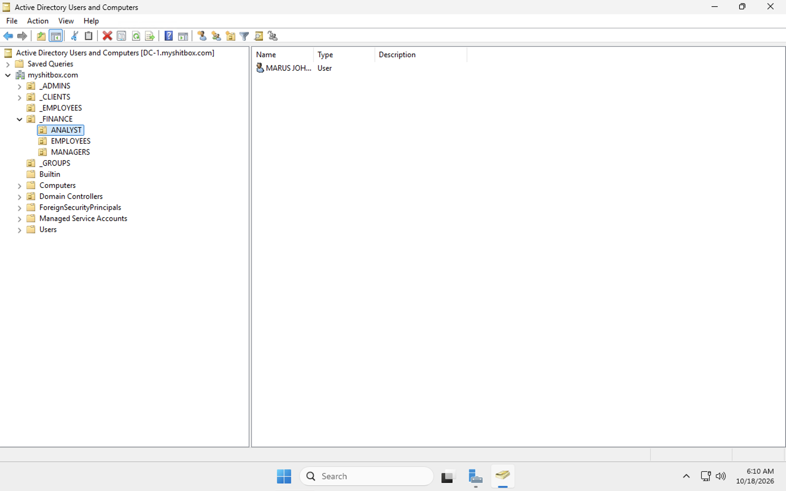
*Figure 1 — Finance Analyst OU in ADUC.*

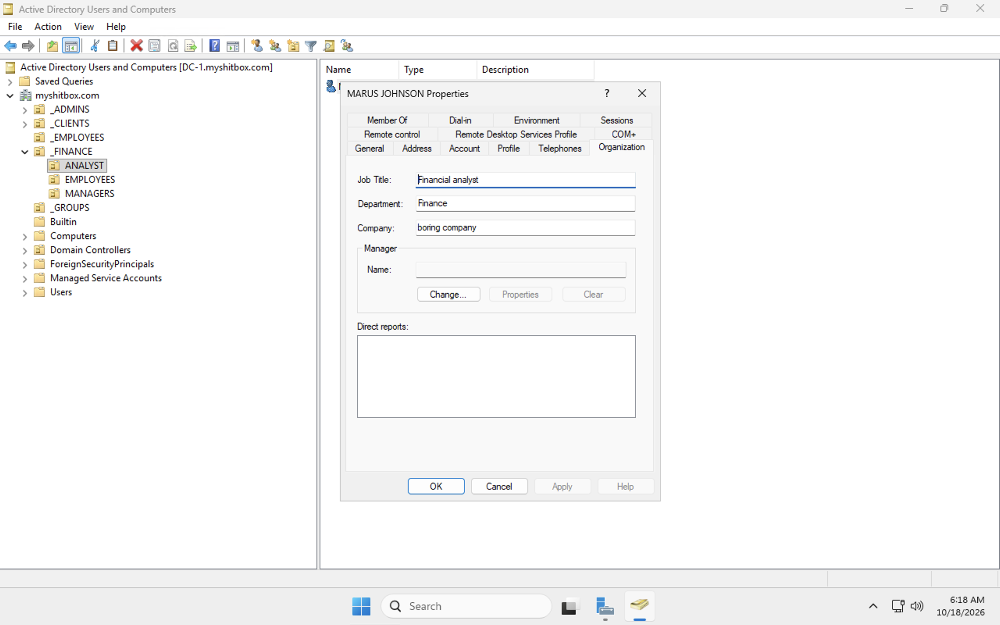
*Figure 2 — Marcus Johnson's employee account details.*

### 2. Assign department access
I assigned Marcus to the Finance read-only security group rather than granting direct permissions to the user.

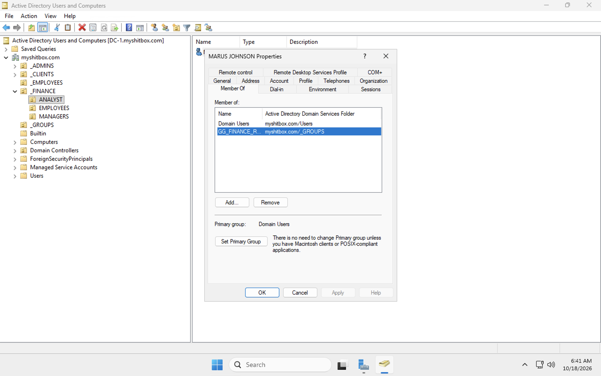
*Figure 3 — Group membership in ADUC.*

### 3. Verify identity attributes using PowerShell
```powershell
Get-ADUser -Identity "marcus.johnson" -Properties Department,Title,Enabled |
    Select-Object Name,SamAccountName,Department,Title,Enabled

Get-ADPrincipalGroupMembership "marcus.johnson" |
    Select-Object Name
```

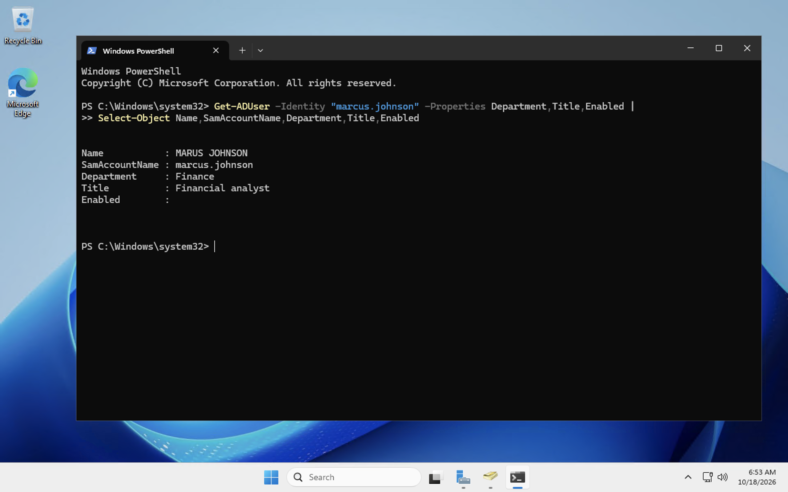
*Figure 4 — Account information checked in PowerShell.*

### 4. Review the Finance resource and permissions
The Finance share was configured with separate read-only and read/write access groups. This project tests the **read-only** role.

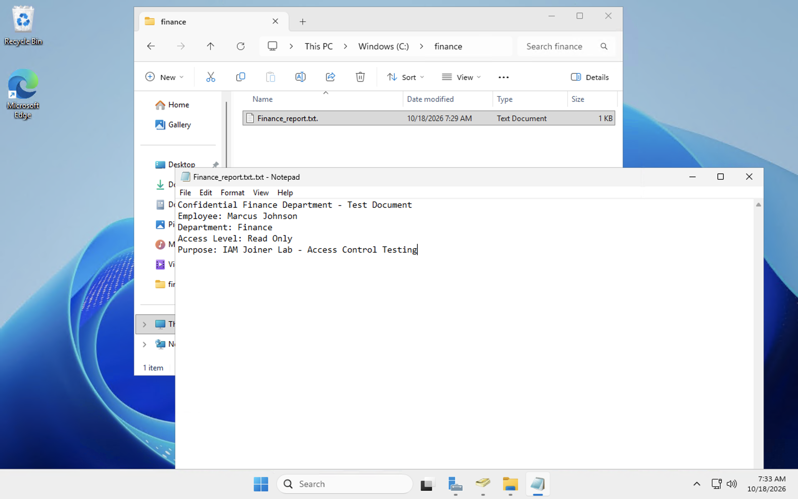
*Figure 5 — Test report in the Finance resource.*

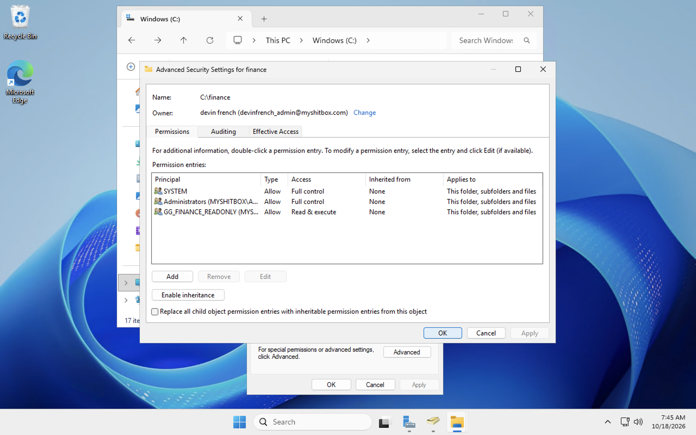
*Figure 6 — NTFS permission configuration.*

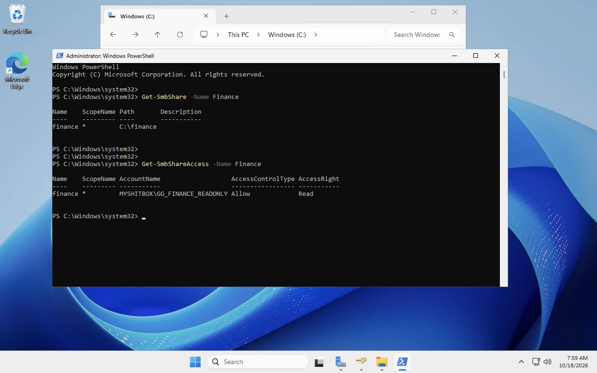
*Figure 7 — Share-level access inspected with PowerShell.*

```powershell
Get-SmbShareAccess -Name "Finance"
Get-Acl "C:\Finance" | Format-List
```

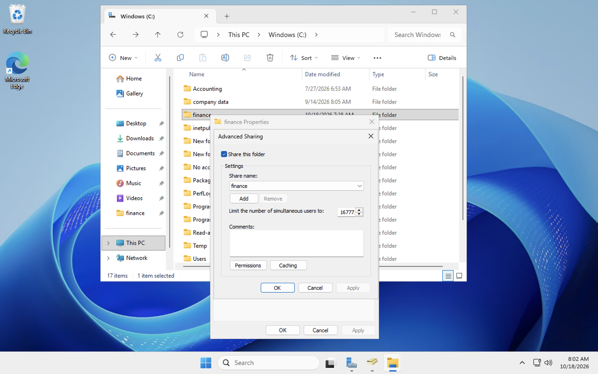
*Figure 8 — Finance share settings.*

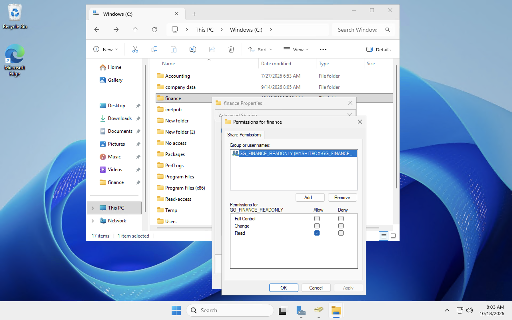
*Figure 9 — Finance permission inspection.*

### 5. Test access from the client VM
I tested Marcus's effective access to `\\DC-1\Finance` from a domain-connected Windows client.

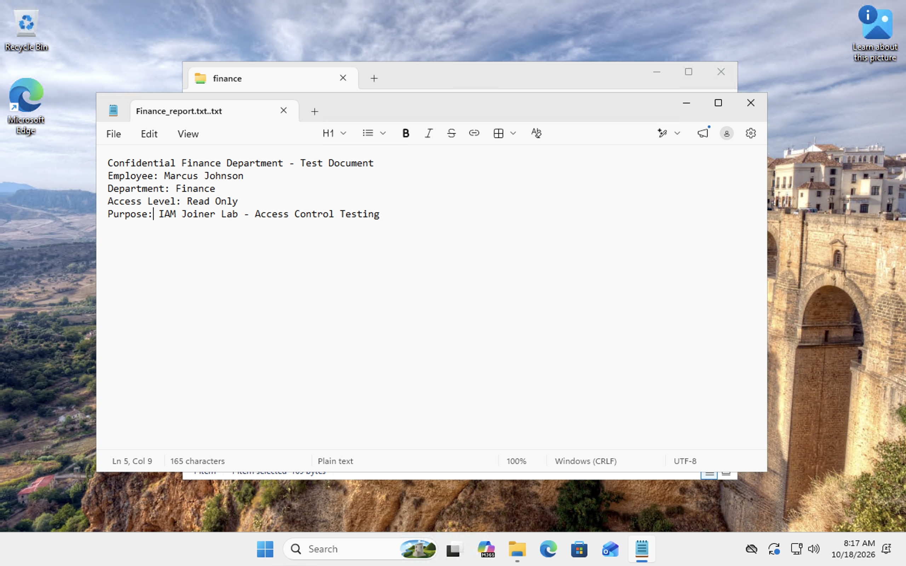
*Figure 10 — Finance report opens successfully.*

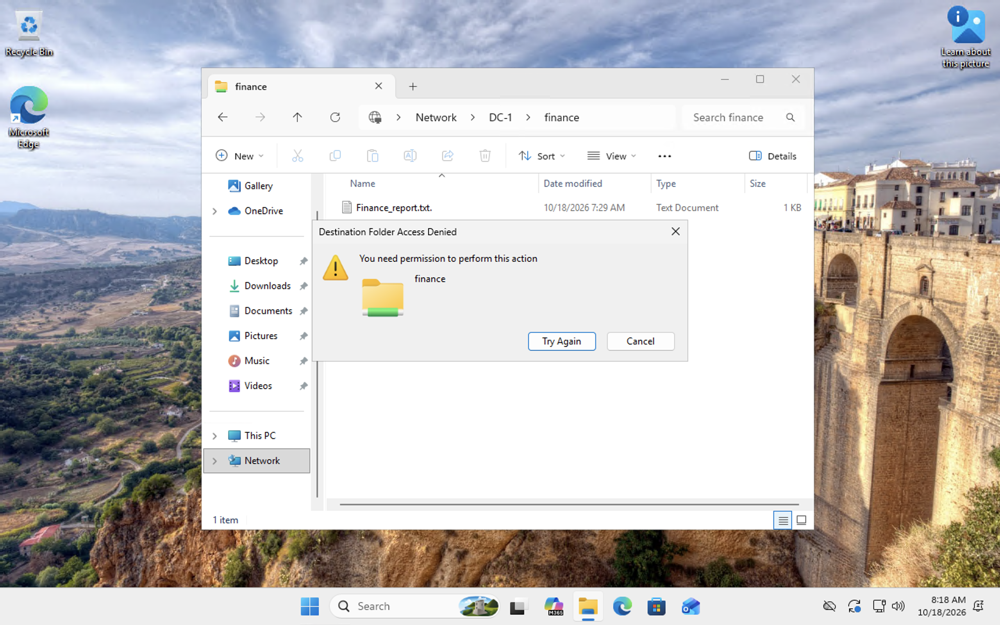
*Figure 11 — File creation is denied.*

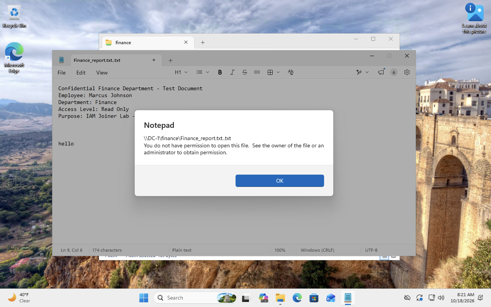
*Figure 12 — Notepad cannot save changes to the protected report.*

## Validation Results
| Test | Observed result |
|---|---|
| User account exists in ADUC | Confirmed |
| Employee attributes reviewed in PowerShell | Confirmed |
| Finance read-only group membership | Confirmed |
| Open existing Finance report | **Allowed** |
| Create file in Finance share | **Denied** |
| Save changes to existing Finance report | **Denied** |

## Security Principles Demonstrated
- **Identity provisioning:** Create and maintain an employee account.
- **RBAC:** Assign access using a security group.
- **Least privilege:** Permit reading without granting write permissions.
- **Access validation:** Verify behavior on a client VM instead of relying only on configuration.
- **Evidence documentation:** Record account state, permissions and positive/negative test results.

## Skills & Tools
Active Directory Users and Computers (ADUC) · Windows Server · Windows client VM · PowerShell · Security groups · NTFS · SMB · Access control testing · Microsoft Azure VMs

## Evidence Directory
See [EVIDENCE-INDEX.md](EVIDENCE-INDEX.md) for a complete, numbered inventory of the original screenshots and their labels.

## Author
**Devin French** · CompTIA Security+  
[GitHub](https://github.com/devin-french)

---
*Portfolio homelab — not a production environment.*
